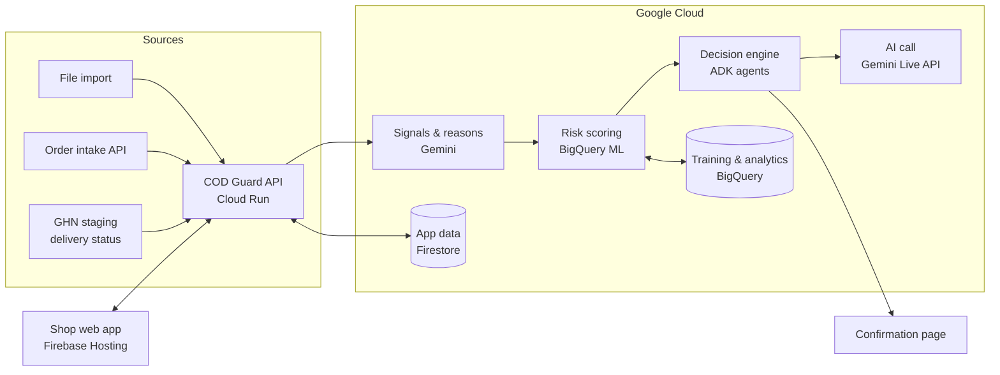

# COD Guard

**Stop failed cash-on-delivery orders before they ship.**

COD Guard is an AI assistant for online sellers in Vietnam. It scores every new cash-on-delivery (COD) order for refusal risk, explains the reasons in plain language, and then takes the least intrusive action that still protects the seller: ship the order, ask the buyer to confirm, have an AI assistant call the buyer, or request a deposit.

> **Status:** prototype in development for the Google Cloud AI Builder Cup 2026 (Retail & Commerce track). Prototype target date: 18 Oct 2026.

---

## Table of Contents

- [The Problem](#the-problem)
- [How It Works](#how-it-works)
- [Key Features](#key-features)
- [Architecture](#architecture)
- [Risk Scoring](#risk-scoring)
- [Contact Protection Rules](#contact-protection-rules)
- [Project Structure](#project-structure)
- [Getting Started](#getting-started)
- [Evaluation](#evaluation)
- [Roadmap](#roadmap)
- [Privacy & Compliance](#privacy--compliance)
- [Team & License](#team--license)

---

## The Problem

Cash on delivery is still one of the most common ways Vietnamese shoppers pay online. When a buyer refuses a parcel (*"bom hàng"*), the seller:

- pays shipping both ways;
- has stock tied up for days;
- often gets goods back damaged or out of season.

Sellers' current options are weak:

| Today | Limitation |
|---|---|
| Manual confirmation calls | Do not scale after a livestream or a sales event that brings in hundreds of orders |
| Carrier risk warnings | Only flag a phone number. They know nothing about first-time buyers and take no action |
| Deposit on every order | Turns away genuine buyers |

COD Guard targets **social-commerce and website sellers** (Facebook, TikTok livestream, Zalo, own website). On these channels the seller has the buyer's phone number and carries the full cost of a failed delivery.

---

## How It Works

1. **Order in:** a COD order arrives by file import or through the order intake API.
2. **Score:** COD Guard estimates the probability of failed delivery, assigns a risk tier and calculates the expected loss in VND.
3. **Explain:** Gemini writes up to 3 short reasons in Vietnamese, based only on signals actually present on the order.
4. **Act:** the decision engine picks the cheapest action worth taking, based on the shop's policy and the expected loss.
5. **Verify:** if needed, an AI voice assistant (Gemini Live) or a confirmation page lets the buyer confirm, edit or cancel the order.
6. **Learn:** delivery outcomes flow back to update phone history and improve the model.

---

## Key Features

- **Risk score and tier** (0–100; Low / Medium / High / Very High) for every COD order, with plain-language reasons
- **Expected-loss decisions:** contacts the buyer only when it is worth the cost, so genuine buyers are rarely disturbed
- **AI confirmation call** in natural Vietnamese:
  - discloses that it is an AI and names the shop;
  - lets the buyer confirm, edit or cancel;
  - reads changes back before ending;
  - records exactly one of 7 outcomes.
- **Buyer confirmation page** (no login): Confirm / Edit address / Cancel / *"I did not place this order"*
- **Anti-abuse protection:** contact limits per phone number, order batching, quiet hours, and automatic blocking when someone reports fake orders
- **Gift-order handling:** verifies with the buyer, never the recipient
- **Review queue and overrides** for staff, with an audit log
- **ROI dashboard and onboarding backtest:** *"Had COD Guard been active last month, it would have caught X failed orders and saved Y VND."*

---

## Architecture

> Planned architecture for the prototype. Details may change during development.



### Tech Stack

| Layer | Technology |
|---|---|
| AI models | Gemini (signal extraction and reasons), Gemini Live API (voice) |
| Agent orchestration | Agent Development Kit (ADK) |
| Risk model | BigQuery ML (boosted trees, with explanations per prediction) |
| Backend | Python service on Cloud Run |
| Frontend | Web app on Firebase Hosting |
| Data | Firestore (app state), BigQuery (training data, analytics) |
| Secrets | Secret Manager |
| Delivery outcomes | GHN staging API, CSV import |
| Region | `asia-southeast1`; Gemini Live API sessions in `us-central1`, because the Live API is not served from Asia regions ([details](docs/gemini-live.md)) |

---

## Risk Scoring

COD Guard evaluates each order in three layers:

1. **Hard rules** handle clear-cut cases:
   - fully prepaid order → skipped;
   - invalid phone number → held for review;
   - phone with a ≥75% return rate over at least 3 past orders → Very High.
2. **Statistical model** (BigQuery ML) turns signals into a probability of failed delivery.
3. **Gemini** extracts signals from unstructured text (address, sales conversation) and writes the reasons. Gemini **never** sets the score.

### Signals

| Group | Examples |
|---|---|
| Phone history | Past deliveries and returns, first-seen date, abuse reports |
| Address quality | Missing house number or ward, vague text, many phones on one address, old vs. new administrative names |
| Order behaviour | Order time, value vs. shop average, several sizes of the same item, unusual quantity, heavy discount |
| Conversation | Buyer asked about size or price, rushed vs. considered decision, name mismatch |
| Velocity | Orders to the same phone or address in 24 hours, accounts per phone |
| Context | Category, sale season, expected delivery time, carrier |
| Payment | Amount still to collect after any deposit |

### Decision Logic

```
expected_loss = P(failed delivery) × cost of one failed delivery (shop settings)
```

The buyer is contacted only if `expected_loss` is higher than the cost of the contact action. Default policy:

| Tier | Default action | If no response |
|---|---|---|
| Low | Ship now | — |
| Medium | Send confirmation link | AI call after 2 hours |
| High | AI call | Hold for review after the last attempt |
| Very High | Require deposit | Hold for review if unpaid |

### Example: BigQuery ML

```sql
CREATE OR REPLACE MODEL cod_guard.risk_model
OPTIONS (
  model_type = 'BOOSTED_TREE_CLASSIFIER',
  input_label_cols = ['is_failed'],
  auto_class_weights = TRUE,
  enable_global_explain = TRUE
) AS
SELECT * EXCEPT(order_id) FROM cod_guard.training_orders;

SELECT *
FROM ML.EXPLAIN_PREDICT(
  MODEL cod_guard.risk_model,
  TABLE cod_guard.new_orders,
  STRUCT(3 AS top_k_features)
);
```

---

## Contact Protection Rules

| Rule | Default |
|---|---|
| Max AI calls per phone number (across all shops) | 1 per 24 hours |
| Orders to the same phone batched into one contact | Within 15 minutes |
| Contact hours | 08:00–21:00 (Vietnam time) |
| Call attempts per order | 2, at least 30 minutes apart |
| Block after *"I did not place this order"* | 30 days, all shops |
| Trust after a confirmed order | 7 days, same shop |
| Gift orders | Verify with the buyer only |
| Call and message content | Order-related only, never promotional |

---

## Project Structure

> Planned layout. It will be updated as the code lands.

```
cod-guard/
├── backend/            # Cloud Run service: API, decision engine, ADK agents
│   ├── app/
│   ├── scoring/        # hard rules, expected loss, model calls
│   ├── agents/         # ADK orchestration
│   ├── voice/          # Gemini Live session handling
│   │   └── prompts/    # AI call system instruction + outcome tool
│   └── tests/
├── docs/               # technical notes (Gemini Live integration)
├── frontend/           # Shop web app + buyer confirmation page
├── ml/                 # data prep, synthetic data generator, BigQuery ML SQL, backtest
├── data/
│   └── seed/           # pseudonymised demo data
├── infra/              # deployment config, Firebase config
├── scripts/            # demo reset, abuse simulation, call test runner
├── .env.example
└── README.md
```

---

## Getting Started

> The commands below reflect the planned setup and will be finalised as the code lands.

### Prerequisites

- Google Cloud project with billing enabled
- Gemini API access on Google Cloud (Vertex AI / Gemini Enterprise Agent Platform)
- BigQuery and Firestore enabled
- `gcloud` CLI and Firebase CLI
- Python 3.11+ and Node.js 20+
- (Optional) GHN staging account for delivery-status testing

### 1. Clone and configure

```bash
git clone https://github.com/<org>/cod-guard.git
cd cod-guard
cp .env.example .env
```

Fill in `.env`:

```bash
GOOGLE_CLOUD_PROJECT=<your-project-id>
GOOGLE_CLOUD_REGION=asia-southeast1
GEMINI_MODEL=<gemini-model-id>
GEMINI_LIVE_MODEL=<gemini-live-model-id>   # gemini-3.8-live, see docs/gemini-live.md
GEMINI_LIVE_LOCATION=us-central1          # Live API is not served from asia-southeast1
BQ_DATASET=cod_guard
GHN_API_BASE_URL=<ghn-staging-url>      # optional
GHN_API_TOKEN=<from-secret-manager>     # optional, never commit
```

### 2. Run the backend locally

```bash
cd backend
python -m venv .venv && source .venv/bin/activate
pip install -r requirements.txt
uvicorn app.main:app --reload --port 8080
```

### 3. Run the frontend locally

```bash
cd frontend
npm install
npm run dev
```

### 4. Load demo data

```bash
python scripts/reset_demo.py      # loads pseudonymised seed orders
```

### 5. Deploy

```bash
gcloud run deploy cod-guard-api --source backend --region asia-southeast1
firebase deploy --only hosting
```

---

## Evaluation

The prototype is evaluated against four types of evidence:

| Evidence | Method | Target |
|---|---|---|
| Catches the right orders | Backtest against two baselines: "phone history only" and "call everyone" | Higher catch rate at the same contact volume |
| Saves money | Cost simulation of 4 policies (do nothing / call all / deposit all / COD Guard) using real carrier fees | Monthly saving for a 300-orders/day shop |
| AI call quality | 50 scripted calls covering confirm, edit, cancel, angry buyer, regional accents, noisy line | ≥ 45 / 50 handled correctly |
| Abuse protection | 50 fake orders from 20 accounts to one phone | Exactly 1 contact, then the phone is blocked |

---

## Roadmap

### Prototype milestones

| Milestone | Date | Goal |
|---|---|---|
| M1 | 9 Oct | Data source chosen, Gemini Live Vietnamese check, deployment pipeline running |
| M2 | 13 Oct | End-to-end flow: order → score → decision → AI call → outcome |
| M3 | 16 Oct | Dashboard, backtest, confirmation page, call tests done (feature freeze) |
| M4 | 18 Oct | Demo video, pitch deck, submission |

### After the prototype

- Real phone calls from a registered number
- Zalo ZNS and SMS through official providers
- Connectors for Pancake, Haravan, Sapo, KiotViet
- Additional carriers: GHTK, Viettel Post, J&T, SPX
- Real deposit payments (VietQR / e-wallets)
- Shared phone reputation across shops, with consent
- Expansion to other COD-heavy markets in Southeast Asia

### Out of scope (prototype)

- Contacting buyers of marketplace orders (Shopee, Lazada, TikTok Shop). These platforms hide buyer contact details.
- Real payments, mobile apps, shop billing

---

## Privacy & Compliance

- Phone numbers are **hashed** wherever they are shared across shops.
- Demo data and videos use **pseudonymised data only**.
- Every AI call **discloses that it is an automated assistant** and names the shop.
- Calls and messages carry **order-related content only**.
- In production, automated calls will use registered numbers in line with Vietnamese regulations on unsolicited calls and messages. Data handling follows Vietnam's personal data protection law.
- Location may contribute to a risk score but is **never the only reason** for a High or Very High tier.

---

## Team & License

- **Team:** [TBD]
- **Hackathon:** Google Cloud AI Builder Cup 2026 — Retail & Commerce: Intelligent Customer and Business Experiences
- **License:** [TBD]
