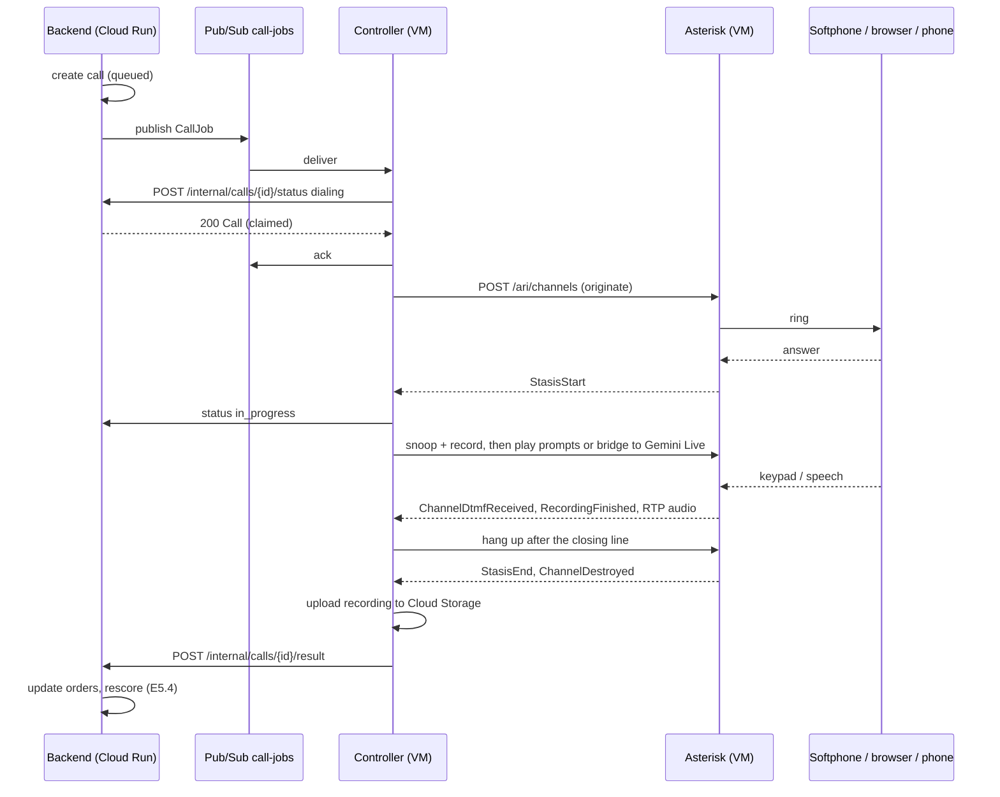

# Call controller: Asterisk, the backend and the AI call

Spec for the voice workstream (E5): how a call gets from the decision engine to a phone and back. For the Gemini Live session itself, read [gemini-live.md](gemini-live.md).

What exists so far:

- The contract: `api/openapi.yaml`, tag `internal`, and the `call-job` webhook.
- One call with the `gemini_live` agent, in `backend/app/telephony/`: ARI client (`ari.py`), RTP for External Media (`rtp.py`, `audio.py`), the Live agent (`live.py`), the outcome checks (`outcome.py`) and the call runner (`call.py`). The dev tool `app.telephony.dial` drives them; see "Try a Gemini call from a softphone".
- The backend side, in `backend/app/calls/`: `POST /orders/{id}/calls` and the pipeline's `call_buyer` node create the call and publish its `CallJob`; `GET /calls/{id}` and the order page show its progress; the internal endpoints take the controller's status and result, and the result runs the rule set's L4 table on the order (see "Backend").
- The controller service on the VM, `python -m app.telephony.controller`: pulls the jobs, claims and places each call, and reports the result from an outbox (see "The controller service").
- Not yet: the `script` agent, recording, language switching, batching several orders into one call.

## Why a controller

- Asterisk carries the call (SIP, audio, keypad, recording), but it never calls our API. It exposes ARI, and a client has to drive it over a WebSocket that stays open for the whole call.
- Cloud Run scales to zero and gives CPU only while a request runs, so the backend cannot hold that WebSocket. The controller runs next to Asterisk on the VM instead.
- The Live API is served from `us-central1`, the VM's region; the backend runs in `asia-southeast1`. A Live session in the controller avoids a Singapore–Iowa round trip on every turn.

## Components

| Component | Runs on | Does |
|---|---|---|
| Backend (`codguard-api`) | Cloud Run, `asia-southeast1` | Decides whether and when to call (contact rules stay here). Creates the call, publishes the job, records progress and the result, updates the orders and triggers the rescore. |
| Pub/Sub topic `call-jobs` | Google Cloud | Carries one job per call attempt to a controller |
| Call controller | Asterisk VM `codguard-asterisk` (`us-central1-a`), Docker | Pulls jobs, drives Asterisk over ARI, runs the agent (script or Gemini Live), records the call, reports back |
| Asterisk | Same VM, Docker, host network | SIP endpoints (softphones, browsers, trunk), audio, keypad, recording |
| Bucket `ai-codguard-call-recordings` | `us-central1` | One WAV per call, deleted after 30 days |

The controller code lives in `backend/app/telephony/` and ships in the backend image; the VM runs it with `python -m app.telephony.controller`. It shares the contract models (`app/schemas/telephony.py`) and the prompts (`backend/voice/`) with the backend, and CI already builds and tests that image.

## Channels

| `target.kind` | How it reaches Asterisk | ARI endpoint | Used for | When |
|---|---|---|---|---|
| `sip` | Softphone (Zoiper, Linphone) registered as extension `6001`–`6009`, over Cloudflare Mesh (`100.96.0.0/12`) | `PJSIP/6001` | Team testing | First |
| `webrtc` | Browser tab with JsSIP or SIP.js: SIP over WSS, DTLS-SRTP media | `PJSIP/web-<session>` | Judges trying the demo | After `sip`; needs TLS on a domain and a TURN server |
| `pstn` | Twilio Elastic SIP Trunk to `34.60.118.169` | `PJSIP/<E.164>@twilio` | Real phones, demo video | After M4 (#70, #36) |

The controller treats all three alike; only the endpoint string changes. Two dialplan extensions help testing from a softphone: `200` is an echo test, and `100` runs the `confirm-v1` script on a built-in sample order without touching the backend.

## Call lifecycle



1. The backend checks the contact rules, creates the call as `queued` and publishes a `CallJob`.
2. The controller claims the call with `status: dialing`. On 2xx it acks the message. On 409 `call_not_active` (cancelled, finished or claimed elsewhere) it acks and drops the job. On any other error it nacks, and Pub/Sub redelivers.
3. It originates with `POST /ari/channels`: `endpoint` from the target, `app=codguard`, `appArgs=<call_id>`, `channelId=<call_id>-<attempt>`, `timeout=<ring_timeout_seconds>`, and the variable `CHANNEL(language)` set to `vi` or `en`. The app is subscribed to the new channel, so ringing and hang-up events arrive before the answer.
4. On `StasisStart` (answered) it reports `in_progress`, starts the recording and starts the agent.
5. The call ends when the agent hangs up after its closing line, when the buyer hangs up (`StasisEnd`), or at `max_duration_seconds`.
6. It uploads the recording and posts the result.

How a call ends decides the result. The controller sets `no_answer` and the `unclear` fallback; the model never does.

| What happened | `status` | `outcome` / `failure_reason` |
|---|---|---|
| Rang out, busy or declined (`ChannelDestroyed` cause 19, 17 or 21) | `completed` | `no_answer` |
| Answered, but the buyer never spoke or pressed a key | `completed` | `no_answer` |
| Answered and talked, but no valid outcome | `completed` | `unclear` |
| Softphone or browser not registered (originate error, or cause 20 or 3) | `failed` | `target_unreachable` |
| ARI unreachable | `failed` | `asterisk_unavailable` |
| Script or Live session broke | `failed` | `agent_error` |

The backend marks a call `failed` (`controller_error`) when it stays `dialing` or `in_progress` for more than `max_duration_seconds` + 2 minutes, so a crashed controller never leaves a call open.

## Backend

`backend/app/calls/` creates calls and applies their results.

- Two ways to start a call, sharing the same two attempts per order (claims `order_id:ai_call:1` and `:2` in `pipeline_claims`):
  - the pipeline: when the engine decides `ai_call`, the `call_buyer` node claims the attempt and places it. Orders from the simulator (`SIM-`, `SIMAI-`) keep a simulated call, so the demo traffic never rings a phone;
  - the shop: `POST /orders/{id}/calls` from the order page. A second click while a call runs returns that call.
- Contact rules checked before a call: a confirmed order and an order whose two attempts are used are never called (409 `contact_blocked`). For the buyer's phone: contact hours (`CONTACT_HOURS`, 08:00–21:00 Vietnam time), at most one AI call per phone per 24 hours across shops (retries of the same order excepted), none for 30 days after `not_ordered`. These phone rules are skipped while `CALL_TARGET_OVERRIDE` sends every call to a test softphone. A call the pipeline wanted but a phone rule stopped is noted on the order, which then waits for its no-response timer.
- The `CallJob` reads amounts and the order time in words (`app/calls/spoken.py`): `450000` → "bốn trăm năm mươi nghìn đồng", "chiều nay", "tối ngày 7 tháng 10". The shop name comes from the simulator's demo shops until shops have profiles (E7).
- The call is stored in `calls/{call_id}` (docs/data-model.md), with a copy of the public `Call` on each order. The transcript stays in the call document.
- A failed publish fails the call (`controller_error`) at once. A call the controller never claims within 10 minutes, or that stays `dialing` or `in_progress` past `ring_timeout_seconds` + `max_duration_seconds` + 2 minutes, fails with `controller_error` when it is next read; a late result from the controller still replaces it.
- A `completed` result runs the pipeline's `on_contact_event` with a `call_outcome` event for each order: `confirmed` clears the order, `edited` applies the read-back changes (address, recipient, item variant or quantity, delivery note) and rescores, `cancelled` and `not_ordered` cancel it, `wrong_person` and `unclear` send it to review, `no_answer` leaves it for the no-response timer. A `failed` result only adds a timeline entry: nobody was reached.

## ARI

- App name `codguard`. Events: `ws://127.0.0.1:8088/ari/events?app=codguard&subscribeAll=false`, HTTP basic auth with user `codguard`. ARI listens on `127.0.0.1` only; from a laptop, use an SSH tunnel through IAP.
- Use an Asterisk LTS release, 20 or later.

| Events the controller handles | Why |
|---|---|
| `ChannelStateChange` (`Ringing`) | Log ringing |
| `StasisStart` / `StasisEnd` | Answered / left the app |
| `ChannelDestroyed` | Hang-up cause before answer (see the table above) |
| `ChannelDtmfReceived` | Keypad digit |
| `ChannelTalkingStarted` / `ChannelTalkingFinished` | Speech, after `TALK_DETECT(set)`; stops the prompt when the buyer talks over it |
| `PlaybackFinished` | Start the answer timer |
| `RecordingFinished` / `RecordingFailed` | Speech answer ready for Speech-to-Text |

| Requests the controller makes | ARI |
|---|---|
| Originate | `POST /channels` |
| Play prompts | `POST /channels/{id}/play?media=sound:codguard/greeting&media=…` |
| Detect speech | `POST /channels/{id}/variable?variable=TALK_DETECT(set)` |
| Record an answer | `POST /channels/{id}/record?name=…&format=wav&maxDurationSeconds=6&maxSilenceSeconds=2` |
| Record the whole call | `POST /channels/{id}/snoop?spy=both&app=codguard`, then record the snoop channel |
| Audio to and from Gemini | `POST /channels/externalMedia`, a mixing bridge (`POST /bridges`) with both channels |
| Hang up | `DELETE /channels/{id}` |

## Agents

`job.agent` picks who speaks for the shop. Both agents share the recording, the language handling and the result format, so the backend cannot tell them apart except by `agent` in the result.

### `script`

- Steps, prompt keys, key map and timeouts come from a script file, `backend/voice/scripts/confirm-v1.yaml` (planned). The wording belongs to E5.3.
- Fixed prompts and number words are generated once with Cloud Text-to-Speech, in the same vi-VN and en-US voices used for dynamic text, and stored as 8 kHz μ-law in `/var/lib/asterisk/sounds/<lang>/codguard/`. Asterisk picks the folder from `CHANNEL(language)`.
- Amounts are built from number-word clips (`say_money_vi`, `say_money_en` in the controller, unit-tested). Free text (shop name, items, address) is synthesised when the job arrives, cached by hash, and ready before dialing.
- Proposed key map, for E5.3 to confirm: `1` confirm, `2` cancel, `3` "Tôi không đặt" (`not_ordered`), `4` wants a change (`unclear` with `human_callback_requested`), `0` repeat, `9` switch language. The script agent never returns `edited`: a new address cannot be typed on a keypad.
- No key within 5 s of a question: ask once more. Then record up to 6 s of speech, send it to Speech-to-Text (`vi-VN` or `en-US`) and match keywords (`có`, `đúng`, `hủy`… / `yes`, `cancel`…). Still nothing: `unclear`.

### `gemini_live`

- Model, session config, instruction, tool and events exactly as in [gemini-live.md](gemini-live.md): `render_instruction`, `live_config`, `[CALL_CONNECTED]`, `[NO_RESPONSE]`, `[TIME_UP]`, `record_call_outcome`.
- The order context is the job minus what the model must not see: drop `orders[].order_id`, the `_vnd` amounts, `call_id`, `target` and everything about routing. Keep `shop_name`, `buyer`, `orders[]` and `total_cod_amount_spoken`.
- Audio: on answer, the controller creates an External Media channel (`format=ulaw`, `encapsulation=rtp`, `transport=udp`, `external_host=127.0.0.1:<port>`), sends to the address in its `UNICASTRTP_LOCAL_*` variables so the agent can speak first, and bridges it with the caller. Caller audio arrives as 8 kHz μ-law: decode it and upsample to the 16 kHz PCM that `send_realtime_input` takes. Model audio is 24 kHz: low-pass filter it, keep every third sample, encode it as μ-law and send it back in 20 ms RTP frames. On `interrupted`, drop the queued audio. Not `slin16`: Asterisk 20.6 sends slin16 to the application but drops what the application sends back (checked against a local Asterisk); μ-law is what the phone leg carries anyway.
- Keys pressed during a Gemini call are sent as `[DTMF:<digit>]` with `send_client_content`. The instruction does not know this event yet (open question 2).
- Mapping the tool call to the result: `order_ref` → `order_id` through the job, the uppercase outcome → the lowercase `CallOutcome`, `summary` → `summary_vi`.

## Language

- The backend sets `job.language`, in this order: the order's language if the shop sent one; the buyer's choice on an earlier call; the country code (`+84` → `vi`, anything else → `en`); otherwise `vi`.
- The opening offers a switch on key `9`: "For English, press 9" in a Vietnamese call, "Để nghe tiếng Việt, bấm phím 9" in an English one. The script agent changes `CHANNEL(language)`; the Gemini agent starts a new session with the other language.
- `result.language` is the language at the end. The backend stores it as the phone's preferred language.

## Recording

- The first prompt says the call is recorded: "Cuộc gọi được ghi âm để xác nhận đơn hàng." / "This call is recorded to confirm your order."
- On answer, the controller snoops the channel (`spy=both`) and records the snoop channel as `<call_id>.wav` in `/var/spool/asterisk/recording/`.
- After the call it uploads `gs://ai-codguard-call-recordings/calls/<call_id>.wav`, deletes the local file and puts the URI in the result. The bucket deletes objects after 30 days.
- Recordings and transcripts are personal data: keep them with the call, never in logs.

## Pub/Sub

| Resource | Name | Settings |
|---|---|---|
| Topic | `call-jobs` | No message retention |
| Subscription | `call-jobs-vm` | Filter `attributes.env = "demo"`, ack deadline 60 s, retry 10 s to 300 s, dead letter after 5 attempts, never expires |
| Subscription, optional | `call-jobs-dev-<name>` | Same, filter `attributes.env = "dev-<name>"`, for a developer's own controller |
| Topic and subscription | `call-jobs-dead`, `call-jobs-dead-inspect` | Jobs that failed 5 times, kept for inspection |

- Message data: the `CallJob` as UTF-8 JSON. Attributes: `env`, `call_id`, `target_kind`, `agent`.
- One topic for every channel: one controller handles them all. Subscriptions split by who consumes the job, not by channel.
- The controller acks right after the claim, not at the end of the call: a call lasts minutes, longer than an ack deadline should. The claim makes redelivery harmless.
- A filter cannot be changed after the subscription is created; make a new subscription instead.
- Cost: within the free 10 GiB a month (about 4 KB per call, published and pulled). No storage cost as long as messages are acked within a day.

## Internal API

| Endpoint | When | Answers |
|---|---|---|
| `POST /api/v1/internal/calls/{call_id}/status` | `dialing` before originating (the claim), `in_progress` on answer | 200 `Call`; 409 `call_not_active` |
| `POST /api/v1/internal/calls/{call_id}/result` | Once, after the call | 200 `Call` (also for an identical repeat); 409 `conflict` for a different result |

- Auth: a Google-signed ID token of the VM's service account. The controller gets it from the metadata server (`GET http://metadata.google.internal/computeMetadata/v1/instance/service-accounts/default/identity?audience=<BACKEND_URL>&format=full`, header `Metadata-Flavor: Google`) and caches it for 55 minutes. The backend verifies it with `google.oauth2.id_token.verify_oauth2_token` against `INTERNAL_AUDIENCE` and accepts only verified emails listed in `CONTROLLER_SERVICE_ACCOUNTS`. No key or shared secret.
- Locally, `INTERNAL_AUTH=off` skips the check. The backend ignores it when `K_SERVICE` is set, that is on Cloud Run.
- Retries: `dialing` must succeed before the controller dials. `in_progress` is best effort (3 tries). The result is retried with backoff until 2xx or 409, from an outbox on disk (`/var/lib/codguard/outbox/<call_id>.json`), so a restart does not lose it.
- The controller does not report single key presses. Keys and speech stay inside the call; the backend gets the decision in the result.

## Configuration

Backend:

| Variable | Example | Meaning |
|---|---|---|
| `CALL_JOBS_TOPIC` | `projects/ai-codguard/topics/call-jobs` | Where jobs go. Unset: calls are not configured, the call endpoints answer 501 (the frontend's mock simulates the call) and the pipeline keeps simulated calls |
| `CALL_ENV` | `demo` | `env` attribute on published jobs; `dev-<name>` on a developer's machine |
| `CALL_TARGET_OVERRIDE` | `sip:6001` | Demo only: send every call to this target instead of the buyer's phone. The per-phone contact rules are skipped while it is set |
| `CALL_AGENT`, `CALL_LANGUAGE` | `gemini_live`, `vi` | Agent and language of new calls (the defaults) |
| `CONTACT_HOURS` | `08:00-21:00` | When a real buyer may be called, Vietnam time |
| `INTERNAL_AUDIENCE` | the backend URL | Expected audience of controller tokens |
| `CONTROLLER_SERVICE_ACCOUNTS` | `codguard-runtime@ai-codguard.iam.gserviceaccount.com` | Who may call the internal API |

Controller:

| Variable | Example | Meaning |
|---|---|---|
| `CONTROLLER_ID` | `codguard-asterisk` | Sent in every status and result |
| `CALL_JOBS_SUBSCRIPTION` | `projects/ai-codguard/subscriptions/call-jobs-vm` | Where jobs come from |
| `BACKEND_URL` | `https://codguard-api-186430269525.asia-southeast1.run.app` | Internal API, also the token audience |
| `ARI_URL`, `ARI_USER`, `ARI_PASSWORD` | `http://127.0.0.1:8088`, `codguard`, from Secret Manager | ARI access |
| `RECORDINGS_BUCKET` | `ai-codguard-call-recordings` | Where recordings go |
| `GOOGLE_CLOUD_PROJECT`, `GEMINI_LIVE_MODEL`, `GEMINI_LIVE_LOCATION` | see gemini-live.md | Gemini agent |

## Running it

### Try a Gemini call from a softphone

`app.telephony.dial` places one call with the sample order from the contract, runs the `gemini_live` agent and prints the `CallResult`. It registers its own ARI app (`codguard-dial`), so it can run next to the controller. On the VM, with a softphone registered as `6001`:

```bash
sudo docker run --rm --network host --env-file /etc/codguard/controller.env \
  asia-southeast1-docker.pkg.dev/ai-codguard/codguard/backend:main \
  python -m app.telephony.dial 6001 --language vi
```

- `infra/asterisk/dev-setup.sh` turns on ARI and writes `/etc/codguard/controller.env`: `ARI_URL`, `ARI_USER`, `ARI_PASSWORD` and the Gemini Live variables.
- Every deploy from `main` also tags the image `main` in Artifact Registry. Pull it once with `sudo gcloud auth configure-docker asia-southeast1-docker.pkg.dev`, then `sudo docker pull …/backend:main` to update. The VM pulls as `codguard-runtime`, which needs reader on the repository (one-time setup).
- Answer, talk, and press keys: keys reach the model as `[DTMF:<digit>]`. The call ends after the agent's closing line, when you hang up, after two silences of 8 s, or at `max_duration_seconds`.
- The log shows ringing, answer, RTP packet counts and the token count, never the transcript. `rtp packets in 0` means Asterisk sent no caller audio; `out 0` means the model never spoke.

### The controller service

`python -m app.telephony.controller` (`backend/app/telephony/controller.py`) runs on the VM next to Asterisk, from the backend image:

- It pulls one job at a time from `CALL_JOBS_SUBSCRIPTION` over the Pub/Sub REST API, claims the call (`dialing`), acks, places the call as ARI app `codguard` with `CallRunner`, reports `in_progress` on the answer and posts the `CallResult`.
- 409 on the claim: the call is cancelled, finished or claimed elsewhere, so the job is acked and dropped. Any other failure: the message is nacked and Pub/Sub redelivers it.
- The result is written to `OUTBOX_DIR` (`/var/lib/codguard/outbox`, the volume `codguard-outbox`) before it is posted, retried with backoff, and posted again at the start of every loop until the backend answers 2xx or 409.
- Auth: an ID token of the VM's service account from the metadata server, audience `BACKEND_URL`, cached for 55 minutes. `ID_TOKEN=off` sends none, for a local backend with `INTERNAL_AUTH=off`.
- The log shows claims, ringing, the answer and delivery, never the transcript.

On the VM, from `infra/asterisk/` (after `dev-setup.sh` wrote `/etc/codguard/controller.env`):

```bash
sudo docker compose pull controller && sudo docker compose up -d controller   # start or update
sudo docker logs -f codguard-controller
```

Without the Compose plugin:

```bash
sudo docker run -d --name codguard-controller --network host --restart unless-stopped \
  --env-file /etc/codguard/controller.env \
  -e CALL_JOBS_SUBSCRIPTION=projects/ai-codguard/subscriptions/call-jobs-vm \
  -e BACKEND_URL=https://codguard-api-186430269525.asia-southeast1.run.app \
  -v codguard-outbox:/var/lib/codguard/outbox \
  asia-southeast1-docker.pkg.dev/ai-codguard/codguard/backend:main python -m app.telephony.controller
```

- Daily testing needs no local setup: register a softphone on the VM over Mesh and start calls from the deployed backend, which sends every call to `CALL_TARGET_OVERRIDE` (`sip:6001`).
- To work on the controller itself: run the backend locally with `CALL_ENV=dev-<name>` and `INTERNAL_AUTH=off`, and the controller against `call-jobs-dev-<name>` with `ID_TOKEN=off`. Use Asterisk in Docker on your machine, or the VM's ARI through an SSH tunnel.
- Unit tests use a fake ARI client, a fake Live session, and fake Pub/Sub and backend (`tests/test_controller_service.py`). CI never needs Asterisk. CI does not deploy to the VM: pull the new image after a merge.

## One-time setup

All in project `ai-codguard`. The repo owner keeps the script for it outside the repo.

- Pub/Sub topics and subscriptions as in the table above. The Pub/Sub service agent needs publisher on `call-jobs-dead` and subscriber on `call-jobs-vm` for dead-lettering.
- `codguard-runtime`: publisher on `call-jobs` (backend), subscriber on `call-jobs-vm` (controller), object user on the recordings bucket, reader on Artifact Registry (to pull the image on the VM). It already has the Speech-to-Text client role.
- Bucket `ai-codguard-call-recordings` in `us-central1` (Cloud Storage's free tier is in US regions), uniform access, public access prevented, delete after 30 days.

## Open questions

1. Key map and script wording (E5.3).
2. The `[DTMF:<digit>]` event in the Gemini instruction (E5.3).
3. WebRTC: domain, TLS for WSS, and TURN (Cloudflare or coturn on the VM).
4. Switching language in a Gemini call: new session, or ask the model to switch.
5. Deploying the controller to the VM from CI.
