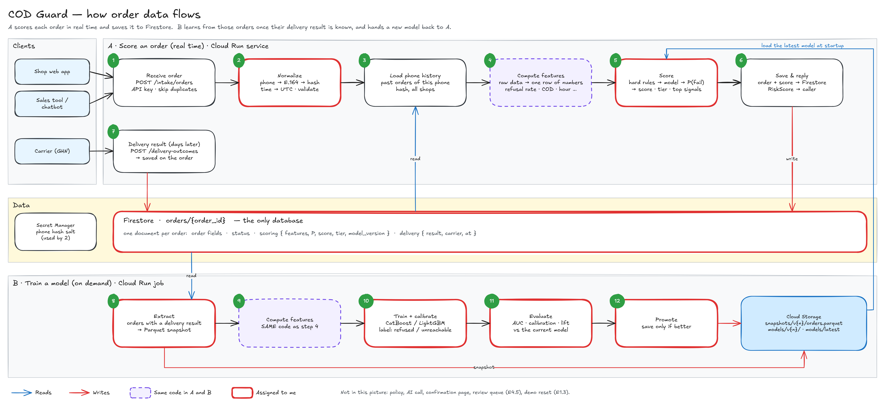

# Order data model (E2.1)

## Stack

| Part | Technology |
|---|---|
| Order database | Firestore (Firebase), collection `orders` |
| Training data and model files | Cloud Storage: Parquet snapshots, model versions |
| Scoring | Backend on Cloud Run |
| Training | Cloud Run job, run on demand |
| Model | Python: CatBoost or LightGBM, scikit-learn calibration |
| Phone hash key | Secret Manager |

## Where the data lives

| Store | Holds | Read by |
|---|---|---|
| Firestore, collection `orders` | Every order: what came in, its status, its latest score and its delivery result | The backend on every request; the training job |
| Cloud Storage, `snapshots/v{n}/orders.parquet` | A frozen copy of the labelled orders used for one training run | Training, backtest (E9) |
| Cloud Storage, `models/v{n}/`, `models/latest` | Model file, metrics, feature list | The backend at startup |

The training job reads Firestore directly. Each model version keeps the snapshot it was trained on.

## Firestore: `orders/{order_id}`

One document per order. It is a top-level collection with a `shop_id` field rather than
`shops/{id}/orders`, so one query finds a phone's orders across all shops (phone history, E1.5).

| Field | Type | Source | Rule |
|---|---|---|---|
| `order_id` | string | system | Same as the document ID |
| `shop_id` | string | system | |
| `external_id` | string \| null | `OrderCreate.external_id` | Unique per shop; a repeat is ignored |
| `channel` | string | `OrderCreate.channel` | One of `SalesChannel` |
| `placed_at` | timestamp | `OrderCreate.placed_at` | Stored in UTC. A time without a zone is Vietnam time (UTC+7) |
| `buyer_name` | string | `OrderCreate.buyer_name` | Shown in the app; never copied into snapshots |
| `buyer_phone` | string | `OrderCreate.buyer_phone` | E.164 (`+84…`). Kept as received if it cannot be normalised |
| `buyer_phone_hash` | string \| null | derived | HMAC-SHA256 of the E.164 number with a secret key. Null means the phone is invalid |
| `is_gift` | bool | `OrderCreate.is_gift` | |
| `recipient_name` | string \| null | `OrderCreate.recipient_name` | |
| `recipient_phone` | string \| null | `OrderCreate.recipient_phone` | E.164 |
| `recipient_phone_hash` | string \| null | derived | Same hashing as the buyer phone |
| `address` | map | `OrderCreate.address` | `raw`, `street`, `ward`, `province` (2025 two-level units) |
| `items` | array of map | `OrderCreate.items` | `sku`, `name`, `variant`, `quantity`, `unit_price_vnd` |
| `shipping_fee_vnd` | int | `OrderCreate.shipping_fee_vnd` | |
| `discount_vnd` | int | `OrderCreate.discount_vnd` | |
| `prepaid_vnd` | int | `OrderCreate.prepaid_vnd` | Deposit or prepayment |
| `conversation_text` | string \| null | `OrderCreate.conversation_text` | |
| `note` | string \| null | `OrderCreate.note` | |
| `status` | string | lifecycle (E4.1) | One of the nine `OrderStatus` values; `new` on creation. Only the lifecycle service changes it |
| `scoring` | map \| null | scoring (E2.4, E2.5) | Latest run: `probability`, `risk_score`, `tier`, `expected_loss_vnd`, `chosen_by`, `hard_rules`, `top_signals`, `model_version`, `scored_at`, and `features`, the exact inputs the model saw. `expected_loss_vnd` = probability × 60,000 VND until E2.5 uses the shop's costs. `top_signals` = the 5 features with the largest SHAP values for this order, rescaled to probability (positive raises risk) |
| `decision` | map \| null | lifecycle (E4.1), policy (E4.2) | Current `Decision`: `decided_at`, `action`, `policy_version`, `expected_loss_vnd`, `contact_cost_vnd`, `block_reasons`, `next_action`, `next_action_at`, `decided_by`. Null until decided |
| `score_history` | array of map | rescore (E4.1) | Earlier `scoring` maps, newest first; starts empty. `OrderDetail.score_history` combines the current score with these earlier runs |
| `confirmation` | map \| null | buyer response, call outcome (E4.1) | `at`, `via` (`link` or `call`); set once after confirmation or a buyer correction. A confirmed order is never contacted again |
| `intervention` | optional map | completed buyer response, call outcome, deposit update (E4.1) | First completed contact assignment: `tier`, `contact_action`, `random_slice`, `action_probability`, original address `province`, plus the original scoring `features` and `probability` when available. Saved before a response or deposit update replaces the current score or decision; preserved on later edits |
| `cancel` | map \| null | buyer response, staff override | `reason` (`cancelled`, `not_ordered`, `shop`), `at`, `by`; buyer cancellation reasons count as failure labels, `shop` alone does not |
| `timeline` | array of map | lifecycle (E4.1) | `OrderEvent` entries, newest first; starts with `created` |
| `delivery` | map \| null | `DeliveryOutcome` | `result`, `carrier`, `tracking_code`, `occurred_at` (UTC) |
| `created_at`, `updated_at` | timestamp | system | |

- Totals are not stored. `total_vnd` = items − discount + shipping fee; `cod_amount_vnd` = total − prepaid.
- Earlier scores are stored in an array on the order for this prototype, so edits, scores, decisions and
  status changes can be written together in one transaction. The order-detail view converts the current
  and prior scoring maps to `RiskScore` values, newest first.
- `contact_action` describes the current decision. A confirmation can clear a pending call or link to
  `none`; the optional `intervention` map retains the completed assignment and its randomization
  metadata. Training and monitoring pair that original tier and action with the features captured
  before a response changes the address or COD amount; monitoring also uses the original probability.
  Training fits province encodings against the captured province and recomputes province encoding
  and phone failure smoothing from the current training encodings and frozen outcome counts. This
  keeps raw assignment inputs fixed while using the same encodings as the new serving model.
  Monitoring retains the exact original encoded features and probability the live model produced.
  Historical documents without captured features retain the existing feature calculation or latest
  scoring fallback, and documents without an intervention use their top-level assignment metadata.
- Phone history query: `buyer_phone_hash == h and placed_at < t`. It needs a composite index on
  (`buyer_phone_hash`, `placed_at`).
- The phone key lives in Secret Manager and is the same for every shop, otherwise a phone would not match
  across shops. A plain SHA-256 of a phone number can be reversed by trying every number, so the key is
  required.

## Training snapshot: `orders.parquet`

One row per order whose buyer cancellation or delivery result gives a label. It is built by the training
job from Firestore:

- copy every field except `buyer_name`, `recipient_name`, `buyer_phone`, `recipient_phone`, `scoring`,
  `status`, `decision`, `score_history`, `timeline`, `confirmation`, `cancel` and `intervention`;
- flatten `address.*` to `address_*` and `delivery.*` to `delivery_*`; keep `items` as a list column;
- add the label `is_failed`.

Scores and decisions are outputs of earlier models. Status, timeline, confirmation and cancellation
records can reveal the eventual outcome. These fields are left out so the new model cannot train on its
target or earlier predictions; `final_state()` still reads cancellation and delivery to derive the label.
The feature table separately includes the completed intervention's assignment metadata for Model 2;
it is excluded from the risk model's features.

### Label

Only buyer-caused failures count (`COD_Guard_Epics.md`, E2.1).

A buyer cancellation with `cancel.reason` equal to `cancelled` or `not_ordered` gives `is_failed = 1`.
`cancel.at` is when that result became known. A shop cancellation alone gives no label. Otherwise the
delivery result determines the label:

| `delivery.result` | `is_failed` |
|---|---|
| `delivered` | 0 |
| `refused` | 1 |
| `unreachable` | 1 |
| `carrier_issue`, `shop_issue` | row dropped |
| not set yet | row dropped |

A carrier export is mapped to `DeliveryResult` first. For GHN, for example: receiver unreachable or not
answering (`GHN-DFC1A2`, `GHN-DFC1A4`), says they did not order (`GHN-DFC1A9`, `GHN-DCD1A1`), changed their
mind (`GHN-DCD0A8`), no money (`GHN-DCD1A5`) → `refused` / `unreachable`; wrong product or wrong COD amount
(`GHN-DCD0A6`, `GHN-DCD0A7`) → `shop_issue`; damaged, lost, weather (`GHN-DCD0A5`, `GHN-DFC2A0`) →
`carrier_issue`.

## Rules for everyone using this data

- **Point in time:** a feature for an order may only use other orders whose delivery result was known
  before this order's `placed_at`.
- **Same code:** training and scoring compute features with the same function (step 4 and step 9 in the
  diagram).
- **Time split:** split train and test by `placed_at`, never at random.

## Open questions for the team

1. The "invalid phone → hold for review" rule versus test data: CI only allows `+84000…` numbers, which are
   not real Vietnamese numbers. Normalisation therefore checks the shape of the number (9 or 10 national
   digits), not whether the prefix exists.
2. `README.md` lists category, carrier and expected delivery time as context signals, but `OrderCreate` has
   no field for them.
