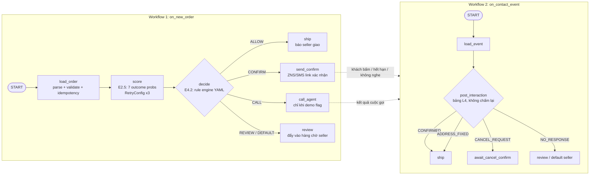

# [E4.7] Điều phối pipeline bằng ADK (chấm điểm → quyết định → liên hệ) — #31

> Epic: E4 — Decision engine (#4) · Ưu tiên: Should · Milestone: M3
> Done khi (gốc): *Một đơn mới chạy hết pipeline tự động.*

---

## 1. Done khi (đề xuất viết rõ hơn)

- [ ] Một đơn mới (JSON từ webhook/seed) đi qua đủ **4 bước**: `load_order → score → decide → act`, không cần người bấm.
- [ ] Nhánh hành động được chọn bằng **route** theo kết quả rule engine: `ALLOW`, `CONFIRM`, `REVIEW` (phase 1). `CALL` chỉ bật khi có cờ demo/phase 2.
- [ ] Action lạ hoặc lỗi → rơi về nhánh **REVIEW** (không bao giờ tự liên hệ khách khi lỗi).
- [ ] Lỗi tạm thời ở bước chấm điểm (API model) được **retry tự động** tối đa 3 lần.
- [ ] Mỗi đơn ghi `decision_log`: `order_id`, xác suất 7 outcome, `action`, `rule_id`, `rule_set_version`.
- [ ] Gọi lại cùng `order_id` không gửi tin nhắn lần 2 (idempotent).
- [ ] Có pytest chạy pipeline end-to-end với 3 đơn mẫu (ALLOW / CONFIRM / lỗi → REVIEW).

---

## 2. ADK là gì, cần biết gì trước khi code

**Agent Development Kit (ADK)** là framework mã nguồn mở của Google để xây agent và workflow. Cài bằng `pip install google-adk`.

### ⚠️ Lưu ý phiên bản (quan trọng)

- Bản mới nhất trên PyPI hôm nay là **`google-adk` 2.11.0**. ADK **2.0** (Python, ra 19/05/2026) đổi lõi sang **engine dạng đồ thị (graph)**.
- Nhiều bài hướng dẫn trên mạng còn viết theo **1.x** (`SequentialAgent`, subclass `BaseAgent` + `_run_async_impl`). Ở 2.x, tài liệu ghi rõ: *override `_run_async_impl()` sẽ bị bỏ qua mà không báo lỗi*, và các workflow dạng template đã được thay bằng graph workflow.
- → Team **dùng 2.x với `Workflow` + function node**, và **giới hạn version** trong `backend/pyproject.toml` (nhận bản 2.x mới hơn, chặn 3.x):

```txt
google-adk>=2.11,<3
```

### Khái niệm dùng cho task này

| Khái niệm | Dùng để | Trong COD Guard |
|---|---|---|
| `Workflow(name, edges=[...])` | Đồ thị các bước, chạy theo thứ tự cố định | Toàn bộ pipeline |
| **Function node** (hàm Python thường) | Bước xử lý không cần LLM. Tham số `node_input` nhận output của bước trước | `load_order`, `score`, `decide`, `ship`… |
| `Event(output=...)` | Trả dữ liệu cho bước sau | Truyền order + xác suất |
| `Event(route="CONFIRM")` | Chọn nhánh | Kết quả rule engine → nhánh hành động |
| `Event(state={...})` | Ghi vào session state (được lưu theo sự kiện) | `risk`, `decision` để log/debug |
| `DEFAULT_ROUTE` | Nhánh dự phòng khi route không khớp | Fallback → `REVIEW` |
| `RetryConfig` | Retry tự động khi node ném exception | Gọi API model chấm điểm |
| `Agent` (LLM) | Bước cần Gemini | Soạn nội dung tin nhắn / voice agent (E5), **không** dùng để quyết định |
| `Runner` + `SessionService` | Chạy workflow từ code/API | Webhook đơn mới gọi vào |

**Nguyên tắc thiết kế:** quyết định (`decide`) là **code tất định** chạy file `cod_guard_rules_apac.yaml`. LLM chỉ dùng ở bước soạn lời / gọi điện. Như vậy kết quả kiểm thử được, giải thích được và không bị "model tự quyết".

---

## 3. Kiến trúc pipeline

Tách **2 workflow** thay vì giữ một workflow chờ khách trả lời hàng giờ:



Lý do tách đôi:
- Khách có thể trả lời sau 2–24 giờ. Workflow 1 kết thúc ngay sau khi gửi tin, tránh giữ trạng thái chờ lâu.
- Workflow 2 chạy bảng L4 (sau tương tác) như rule đã thống nhất: **không chạy lại model (không RESCORE)**.
- ADK có cơ chế dừng chờ người (`RequestInput`) nhưng phù hợp hơn cho bước seller duyệt `REVIEW` trong demo, không cho việc chờ khách hàng giờ.

---

## 4. Code khung (đã chạy thử với `google-adk==2.11.0`)

`codguard/pipeline/agent.py` — đặt tên biến `root_agent` để dùng được với `adk web` / `adk run`:

```python
import json
from google.adk import Workflow, Event
from google.adk.workflow import DEFAULT_ROUTE, node, RetryConfig
from google.genai import types

from codguard.scoring import predict_outcomes          # E2.5
from codguard.engine import decide_action               # E4.2 (đọc YAML)
from codguard.contact import send_confirm_link, enqueue_review, notify_ship
from codguard.store import already_decided, write_decision_log


def load_order(node_input: types.Content) -> dict:
    """START: parse đơn từ message, chặn chạy trùng."""
    order = json.loads(node_input.parts[0].text)
    if already_decided(order["order_id"]):
        raise ValueError(f"duplicate {order['order_id']}")   # không retry, rơi lỗi
    return order


@node(retry_config=RetryConfig(max_attempts=3, initial_delay=1.0))
def score(node_input: dict):
    """Gọi model chấm điểm. Lỗi mạng → ném exception để ADK retry (đừng try/except rộng)."""
    probs = predict_outcomes(node_input)                    # {"DELIVERED": .., "RTO_REFUSAL": .., ...}
    yield Event(state={"risk": probs})
    yield Event(output={"order": node_input, "probs": probs})


def decide(node_input: dict):
    """Rule engine tất định → action + rule_id, chọn nhánh bằng route."""
    result = decide_action(node_input["order"], node_input["probs"])
    write_decision_log(node_input["order"], node_input["probs"], result)
    yield Event(state={"decision": result})
    yield Event(output=node_input["order"], route=result["action"])


def ship(node_input: dict) -> dict:
    return notify_ship(node_input)


def send_confirm(node_input: dict) -> dict:
    return send_confirm_link(node_input)                    # ZNS/SMS, idempotency key = order_id


def review(node_input: dict) -> dict:
    return enqueue_review(node_input)


root_agent = Workflow(
    name="cod_guard_on_new_order",
    edges=[
        ("START", load_order, score, decide),
        (decide, {
            "ALLOW": ship,
            "CONFIRM": send_confirm,
            DEFAULT_ROUTE: review,          # REVIEW, CALL khi chưa bật, hoặc action lạ
        }),
    ],
)
```

Chạy từ webhook / script (đây là cách hệ thống gọi pipeline khi có đơn mới):

```python
import asyncio, json
from google.adk import Runner
from google.adk.sessions import InMemorySessionService   # production: DatabaseSessionService
from google.genai import types
from codguard.pipeline.agent import root_agent

session_service = InMemorySessionService()
runner = Runner(app_name="codguard", node=root_agent, session_service=session_service)

async def run_pipeline(order: dict, tenant_id: str):
    s = await session_service.create_session(app_name="codguard", user_id=tenant_id)
    msg = types.Content(role="user", parts=[types.Part(text=json.dumps(order))])
    async for ev in runner.run_async(user_id=tenant_id, session_id=s.id, new_message=msg):
        if ev.output is not None:
            print(ev.output, ev.actions.route)
```

Kết quả chạy thử bản prototype (model và rule engine là stub):

```
A1 (300k, khách cũ)     -> route='ALLOW'   state.decision={'action': 'ALLOW', 'rule_id': 'A06'}
B2 (2.5tr, khách mới)   -> route='CONFIRM' state.decision={'action': 'CONFIRM', 'rule_id': 'A03'}
route='CALL' không có nhánh -> rơi vào DEFAULT_ROUTE (review)  ✅
score lỗi ConnectionError 2 lần -> retry, lần 3 thành công     ✅
```

### Thêm bước LLM (khi làm E5 — soạn tin / voice)

```python
from google.adk import Agent

composer = Agent(
    name="confirm_message_composer",
    model="gemini-flash-latest",
    instruction=(
        "Soạn tin nhắn xác nhận đơn COD tiếng Việt, ngắn gọn, lịch sự. "
        "Không hứa khuyến mãi, không giới thiệu sản phẩm khác. "
        "Ghi rõ đây là tin nhắn tự động."
    ),
)
# edges: (decide, {"CONFIRM": (composer, send_confirm), ...})
```

> Phần LLM này **chưa chạy thử** (cần `GOOGLE_API_KEY` hoặc Vertex AI). Cần test khi có key. Nội dung phải tuân `agent_output_contract` và `permissions` trong YAML.

---

## 5. State và log

| Key state | Ghi ở | Nội dung |
|---|---|---|
| `risk` | `score` | Xác suất 7 outcome |
| `decision` | `decide` | `action`, `rule_id`, `rule_set_version`, `propensity` (nếu exploration) |
| `contact` | `send_confirm` | kênh, message_id, thời điểm gửi |

- Chỉ ghi state qua `Event(state=...)` (hoặc ToolContext/CallbackContext). Không sửa `session.state` trực tiếp ngoài workflow: dễ mất khi dùng session lưu DB.
- `InMemorySessionService` mất hết khi restart → chỉ dùng cho dev/demo. Production dùng `DatabaseSessionService` hoặc `VertexAiSessionService`.
- `decision_log` là bảng riêng của mình (append-only), không dựa vào session ADK để làm log nghiệp vụ.
- `user_id` = `tenant_id` để tách dữ liệu theo seller.

---

## 6. Lỗi, retry, idempotency

- Ở ADK 2.x framework **tự retry**. Trong tool/node **đừng `except Exception:` bao hết**, sẽ chặn retry. Đừng bắt `BaseException` (làm hỏng cơ chế dừng chờ người).
- Retry chỉ cho lỗi tạm thời (mạng, 5xx). Lỗi dữ liệu (thiếu field) → không retry, đơn vào `REVIEW`.
- Ghi chú từ ADK: *số lần retry không được lưu qua resume.*
- Gửi tin dùng idempotency key = `order_id + action`, để retry không gửi 2 tin cho khách. Riêng cuộc gọi AI có 2 lần gọi, nên mỗi lần có key riêng (`order_id:ai_call:1`, `:2`) gắn với quyết định tạo ra nó; số lần gọi được ghi vào đơn (`attempts.ai_call`) để timer biết gọi lần 2 hay chuyển duyệt.
- Kiểm tra `already_decided(order_id)` ở bước đầu.

---

## 7. Test

```bash
cd backend && uv sync
uv run pytest tests/test_pipeline.py -q
adk web codguard/      # mở UI xem từng node, input/output, state
```

Test tối thiểu:
1. Đơn rủi ro thấp → `ALLOW`, không gọi `send_confirm`.
2. Đơn rủi ro cao → `CONFIRM`, gọi `send_confirm` đúng 1 lần.
3. `score` lỗi 2 lần rồi thành công → vẫn ra quyết định.
4. `decide` trả `CALL` khi chưa bật cờ → vào `review`.
5. Chạy lại cùng `order_id` → không gửi tin lần 2.
6. `decision_log` có đủ `rule_id`, `rule_set_version`.

---

## 8. Việc cần làm (ước lượng)

| # | Việc | Phụ thuộc | Est. |
|---|---|---|---|
| 1 | Setup `google-adk==2.11.0`, cấu trúc thư mục `codguard/pipeline/` | — | 0.5h |
| 2 | Node `load_order` + idempotency | E4.1 (state đơn) | 1h |
| 3 | Node `score` gọi model, retry | E2.5 | 1h |
| 4 | Node `decide` gọi evaluator YAML + `decision_log` | **E4.2 evaluator** | 1h |
| 5 | Nhánh `ship` / `send_confirm` / `review` (stub được trước) | E5 kênh liên hệ | 1.5h |
| 6 | Workflow 2 `on_contact_event` (bảng L4) | E4.2 | 2h |
| 7 | Endpoint webhook gọi `Runner` | backend | 1h |
| 8 | pytest 6 case + chạy `adk web` demo | — | 1.5h |

**Tổng ~1–1.5 ngày.** Có thể làm song song: dùng stub cho `score` và `decide` ngay hôm nay, thay bằng code thật khi E2.5 và E4.2 xong.

---

## 9. Bẫy thường gặp

- Copy code từ bài hướng dẫn ADK 1.x (`SequentialAgent`, `_run_async_impl`) → không chạy như mong muốn trên 2.x.
- Để LLM quyết định ALLOW/CONFIRM → không kiểm thử được, trái với rule engine.
- Quên `DEFAULT_ROUTE` → action mới (CALL, DEPOSIT) không có nhánh.
- Dùng `InMemorySessionService` trên server thật → mất state khi deploy lại.
- Một workflow chờ khách trả lời nhiều giờ → khó vận hành; dùng workflow thứ 2 theo sự kiện.

---

## Nguồn

- [ADK 2.0 — thay đổi so với 1.x](https://adk.dev/2.0/)
- [ADK — Graph workflows](https://adk.dev/graphs/)
- [ADK — Dynamic workflows](https://adk.dev/graphs/dynamic/)
- [ADK — Session state](https://adk.dev/sessions/state/)
- [ADK — Function tools](https://adk.dev/tools-custom/function-tools/)
- [ADK — Runtime (`adk web`, `adk run`, `adk api_server`)](https://adk.dev/runtime/)
- [google-adk trên PyPI](https://pypi.org/project/google-adk/)
- API kiểm tra trực tiếp từ package `google-adk==2.11.0` (chữ ký `Workflow`, `Runner`, `node`, `RetryConfig`, `DEFAULT_ROUTE`).
