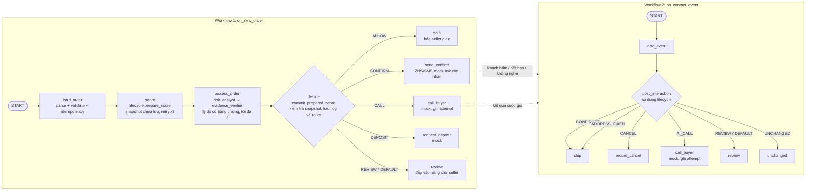

# [E4.7] Điều phối pipeline bằng ADK (chấm điểm → quyết định → liên hệ) — #31

> Epic: E4 — Decision engine (#4) · Ưu tiên: Should · Milestone: M3
> Done khi (gốc): *Một đơn mới chạy hết pipeline tự động.*

## Trạng thái triển khai

Code chạy hiện tại nằm trong `backend/app/agents/`; đoạn code ở mục 4 là prototype tham khảo,
không phải code production. `POST /v1/intake/orders` chạy `on_new_order` trước khi trả response:
`load_order → score → assess_order → decide → act`. Các nhánh liên hệ trả `mock: true`; kênh thật thuộc E5.

`on_contact_event` đã có runner và test, nhưng **chưa nối endpoint hoặc timer production**.
Vì vậy, việc leo thang sau khi không phản hồi hiện chỉ chạy khi code/script gọi runner;
hai workflow có test không có nghĩa là timer đã được triển khai.

`assess_order` đã chạy hai ADK `Agent` thật theo thứ tự `risk_analyst → evidence_verifier` để
chọn và kiểm tra lý do dựa trên model score, SHAP và context đã lọc. Đây là multi-agent
assessment mang tính tư vấn: engine tất định vẫn sở hữu score, tier và action theo AGENTS.md.
Xem ranh giới lưu quyết định ở mục 3 và [nội dung PR](E4.7_PR_description.md).

---

## 1. Done khi (đề xuất viết rõ hơn)

- [x] Một đơn mới từ intake đi qua đủ **5 bước**: `load_order → score → assess_order → decide → act`, không cần người bấm.
- [x] `score` chuẩn bị snapshot chưa lưu; `decide` kiểm tra đơn chưa thay đổi rồi lưu score và quyết định tất định trong transaction sau assessment.
- [x] Hai agent chỉ chọn tối đa 3 lý do tiếng Việt đúng nguyên văn candidate, có signal thật; output lạ hoặc lý do không có bằng chứng bị từ chối.
- [x] Nhánh hành động được chọn bằng **route** theo kết quả engine: `ALLOW`, `CONFIRM`, `CALL`, `DEPOSIT`, `REVIEW`. Nhánh liên hệ hiện là mock; không có cờ riêng bật `CALL`.
- [x] Action lạ, lỗi sau retry, assessment lỗi/timeout hoặc snapshot đã đổi → nhánh **REVIEW** (hết quota thì ghi `quota_exhausted` và engine quyết định như khi tắt Gemini), không tự liên hệ khách trên nhánh lỗi. Khi chưa có risk model, đơn ở trạng thái mới với kết quả `not_scored`, không gọi agent.
- [x] Lỗi tạm thời ở bước chấm điểm được **retry tự động** tối đa 3 lần; lỗi dữ liệu không retry.
- [x] Ghi `decision_log`: `order_id`, `action`, `rule_id`, `rule_set_version`, phiên bản policy và xác suất model hiện có. `probs` có thể rỗng cho tới khi model E2.5 trả đủ 7 outcome.
- [x] Gọi lại cùng đơn/quyết định không gửi thêm; từng lần gọi AI có claim riêng và không vượt 2 lần.
- [x] Có pytest chạy graph ADK thật cho ALLOW / CONFIRM / lỗi → REVIEW và hồi quy lần gọi AI thứ hai.

Các mục trên xác nhận pipeline với kênh mock. Chúng không xác nhận tích hợp E5 hoặc timer production.

---

## 2. ADK là gì, cần biết gì trước khi code

**Agent Development Kit (ADK)** là framework mã nguồn mở của Google để xây agent và workflow. Cài bằng `pip install google-adk`.

### ⚠️ Lưu ý phiên bản (quan trọng)

- Code hiện tại được kiểm thử với **`google-adk` 2.11.0** trong `backend/uv.lock`; dùng **engine dạng đồ thị (graph)** của ADK 2.x.
- Nhiều bài hướng dẫn trên mạng còn viết theo **1.x** (`SequentialAgent`, subclass `BaseAgent` + `_run_async_impl`). Ở 2.x, tài liệu ghi rõ: *override `_run_async_impl()` sẽ bị bỏ qua mà không báo lỗi*, và các workflow dạng template đã được thay bằng graph workflow.
- → Team **dùng 2.x với `Workflow` + function node**, và **giới hạn version** trong `backend/pyproject.toml` (nhận bản 2.x mới hơn, chặn 3.x):

```txt
google-adk>=2.11,<3
```

Range cho phép nâng cấp 2.x; lock vẫn giữ 2.11.0 để tái lập bản đã kiểm thử. Đổi range không
tự gỡ giới hạn dependency từ upstream: ADK yêu cầu `websockets>=15.0.1,<16` và
`opentelemetry-api/sdk<=1.42.1`; bản `google-genai` đang khóa yêu cầu `tenacity<9.2.0`.

Các bản trong lock hiện là FastAPI 0.141.1, google-api-core 2.34.0, websockets 15.0.1,
opentelemetry-api 1.42.1 và tenacity 9.1.4. Các bản FastAPI 0.143.0 và google-api-core 2.42.0
yêu cầu opentelemetry-api từ 1.44.0 nên xung đột với cap của ADK. Chưa có kiểm thử phiên Live thật
với websockets 15.x; cần xác nhận audio, tool outcome và reconnect khi tích hợp E5.

Giải thích model dùng `shap>=0.48,<1`; `uv.lock` khóa SHAP 0.53.0. Việc thêm SHAP không
gỡ các cap dependency chung của ADK nêu trên.

### Khái niệm dùng cho task này

| Khái niệm | Dùng để | Trong COD Guard |
|---|---|---|
| `Workflow(name, edges=[...])` | Đồ thị các bước, chạy theo thứ tự cố định | Toàn bộ pipeline |
| **Function node** (hàm Python thường) | Bước xử lý không cần LLM. Tham số `node_input` nhận output của bước trước | `load_order`, `score`, `decide`, `ship`… |
| `Event(output=...)` | Trả dữ liệu cho bước sau | Truyền order + xác suất |
| `Event(route="CONFIRM")` | Chọn nhánh | Kết quả rule engine → nhánh hành động |
| `Event(state={...})` | Ghi vào session state (được lưu theo sự kiện) | `risk`, `decision` để log/debug |
| `DEFAULT_ROUTE` | Nhánh dự phòng khi route không khớp | Fallback → `REVIEW` |
| `RetryConfig` | Retry tự động khi node ném exception | Gọi API model chấm điểm |
| `Agent` (LLM) | Bước cần Gemini | `risk_analyst` và `evidence_verifier` chọn/kiểm tra lý do; soạn tin và voice thuộc E5; **không** dùng để quyết định |
| `Runner` + `SessionService` | Chạy workflow từ code/API | Webhook đơn mới gọi vào |

**Nguyên tắc thiết kế:** `app/risk/engine.py` và `app/decision/policy.py` quyết định score, tier,
action; policy đọc `tier_policy` trong YAML. LLM không thay đổi các giá trị này.

---

## 3. Kiến trúc pipeline

Tách **2 workflow** thay vì giữ một workflow chờ khách trả lời hàng giờ:



Lý do tách đôi:
- Khách có thể trả lời sau 2–24 giờ. Workflow 1 kết thúc ngay sau khi gửi tin, tránh giữ trạng thái chờ lâu.
- Xác nhận, hủy và timer dùng trạng thái/score đã lưu. Nếu người mua sửa đơn, lifecycle vẫn chấm lại theo E4.1; đơn đã xác nhận không bị liên hệ lại.
- ADK có cơ chế dừng chờ người (`RequestInput`) nhưng phù hợp hơn cho bước seller duyệt `REVIEW` trong demo, không cho việc chờ khách hàng giờ.

### Multi-agent assessment đã triển khai

`score` dùng `lifecycle.prepare_score` để tính snapshot ngoài transaction, chưa lưu score hay
quyết định. `assess_order` nhận bản sao của snapshot; agent không sửa được input quyết định.
`decide` dùng `commit_prepared_score` để kiểm tra đơn hiện tại vẫn khớp snapshot ban đầu,
áp dụng policy tất định và lưu nguyên tử trước khi chạy action. Đơn thay đổi giữa hai bước
được đưa vào review. `lifecycle.score_order` vẫn giữ cho các caller khác.

`backend/app/agents/assessment.py` chứa workflow `risk_analyst → evidence_verifier`, dùng
model từ `GEMINI_MODEL`. Analyst chọn lý do; verifier chỉ được giữ hoặc bỏ lý do đã đề xuất.
Cả hai trả schema chỉ có `reasons`, tối đa 3 mục. Code tạo candidate tiếng Việt từ giá trị
numeric feature thật và kiểm tra chính xác cả `text_vi` lẫn `signal_keys`. Agent không được
sáng tác wording mới hoặc ghi score, tier, action. Context gửi tới model chỉ gồm feature số,
kết quả scoring, SHAP có sẵn và context giới hạn (`channel`, `is_gift`, số tiền COD); không
có tên, số điện thoại, địa chỉ hay ghi chú của khách. Vị trí địa lý không tạo candidate lý do
đứng một mình.

`explain1` tính SHAP chính xác (TreeSHAP) cho mọi feature của Model 1, quy đổi về xác suất của
model trước calibration (isotonic giữ nguyên thứ tự và dấu). `scoring.shap` lưu base value,
prediction và contribution theo feature; `scoring.top_signals` là 5 contribution lớn nhất cho API.
Lỗi khi giải thích trả `available: false`, không chặn việc chấm điểm; không thay bằng feature
importance hay SHAP giả. SHAP dùng để hiểu model, không được thay đổi score hoặc action.

Các nhánh bỏ qua được ghi rõ: thiếu `GEMINI_MODEL` → `disabled`, tiếp tục engine tất định;
hard rule hoặc đơn đã xác nhận → `skipped`; không có candidate → `no_evidence`. Thiếu risk
model → `not_scored`, không gọi assessment. Nếu đã cấu hình model nhưng gọi lỗi, timeout,
output sai hoặc snapshot stale, pipeline chuyển review trước khi liên hệ khách. Hết quota
trong ngày → `quota_exhausted`, đơn đi tiếp theo engine tất định, không có lý do Gemini.

Quota dùng claim nguyên tử trong `DecisionLog`, dùng chung cho mọi shop theo ngày UTC:
`ASSESSMENT_DAILY_LIMIT` mặc định 30 lượt assessment/ngày, chỉ nhận 1–30; lượt đã claim
vẫn tiêu thụ quota nếu assessment lỗi. Mỗi assessment cho tối đa 2 request LLM, 1 HTTP
attempt mỗi request và timeout 15 giây cho workflow hai agent; không retry assessment.
Metadata assessment và lý do hợp lệ được lưu trong scoring và decision log.

---

## 4. Code khung prototype (đã chạy thử với `google-adk==2.11.0`)

Đoạn dưới giữ làm tham khảo cho graph, retry và route. Nó dùng stub và chưa có assessment,
không thể hiện ranh giới lưu quyết định hiện tại. Code chạy thật ở `backend/app/agents/agent.py`
và `backend/app/agents/assessment.py`; kiến trúc hiện tại nằm ở mục 3.

`codguard/pipeline/agent.py` — đặt tên biến `root_agent` để dùng được với `adk web` / `adk run`:

```python
import json
from google.adk import Workflow, Event
from google.adk.workflow import DEFAULT_ROUTE, node, RetryConfig
from google.genai import types

from codguard.scoring import predict_outcomes          # E2.5
from codguard.engine import decide_action               # E4.2 (đọc YAML)
from codguard.contact import send_confirm_link, enqueue_review, notify_ship
from codguard.store import already_decided, write_decision_log


def load_order(node_input: types.Content) -> dict:
    """START: parse đơn từ message, chặn chạy trùng."""
    order = json.loads(node_input.parts[0].text)
    if already_decided(order["order_id"]):
        raise ValueError(f"duplicate {order['order_id']}")   # không retry, rơi lỗi
    return order


@node(retry_config=RetryConfig(max_attempts=3, initial_delay=1.0))
def score(node_input: dict):
    """Gọi model chấm điểm. Lỗi mạng → ném exception để ADK retry (đừng try/except rộng)."""
    probs = predict_outcomes(node_input)                    # {"DELIVERED": .., "RTO_REFUSAL": .., ...}
    yield Event(state={"risk": probs})
    yield Event(output={"order": node_input, "probs": probs})


def decide(node_input: dict):
    """Rule engine tất định → action + rule_id, chọn nhánh bằng route."""
    result = decide_action(node_input["order"], node_input["probs"])
    write_decision_log(node_input["order"], node_input["probs"], result)
    yield Event(state={"decision": result})
    yield Event(output=node_input["order"], route=result["action"])


def ship(node_input: dict) -> dict:
    return notify_ship(node_input)


def send_confirm(node_input: dict) -> dict:
    return send_confirm_link(node_input)                    # ZNS/SMS, idempotency key = order_id


def review(node_input: dict) -> dict:
    return enqueue_review(node_input)


root_agent = Workflow(
    name="cod_guard_on_new_order",
    edges=[
        ("START", load_order, score, decide),
        (decide, {
            "ALLOW": ship,
            "CONFIRM": send_confirm,
            DEFAULT_ROUTE: review,          # REVIEW, CALL khi chưa bật, hoặc action lạ
        }),
    ],
)
```

Chạy từ webhook / script (đây là cách hệ thống gọi pipeline khi có đơn mới):

```python
import asyncio, json
from google.adk import Runner
from google.adk.sessions import InMemorySessionService   # production: DatabaseSessionService
from google.genai import types
from codguard.pipeline.agent import root_agent

session_service = InMemorySessionService()
runner = Runner(app_name="codguard", node=root_agent, session_service=session_service)

async def run_pipeline(order: dict, tenant_id: str):
    s = await session_service.create_session(app_name="codguard", user_id=tenant_id)
    msg = types.Content(role="user", parts=[types.Part(text=json.dumps(order))])
    async for ev in runner.run_async(user_id=tenant_id, session_id=s.id, new_message=msg):
        if ev.output is not None:
            print(ev.output, ev.actions.route)
```

Kết quả chạy thử bản prototype (model và rule engine là stub):

```
A1 (300k, khách cũ)     -> route='ALLOW'   state.decision={'action': 'ALLOW', 'rule_id': 'A06'}
B2 (2.5tr, khách mới)   -> route='CONFIRM' state.decision={'action': 'CONFIRM', 'rule_id': 'A03'}
route='CALL' không có nhánh -> rơi vào DEFAULT_ROUTE (review)  ✅
score lỗi ConnectionError 2 lần -> retry, lần 3 thành công     ✅
```

### Tham khảo bước LLM cho E5 — soạn tin / voice

```python
import os
from google.adk import Agent

composer = Agent(
    name="confirm_message_composer",
    model=os.environ["GEMINI_MODEL"],
    instruction=(
        "Soạn tin nhắn xác nhận đơn COD tiếng Việt, ngắn gọn, lịch sự. "
        "Không hứa khuyến mãi, không giới thiệu sản phẩm khác. "
        "Ghi rõ đây là tin nhắn tự động."
    ),
)
# edges: (decide, {"CONFIRM": (composer, send_confirm), ...})
```

> Composer E5 này **chưa chạy thử** (cần `GOOGLE_API_KEY` hoặc Vertex AI), khác với hai agent assessment đã triển khai ở mục 3. Assessment được test qua ADK thật với LLM giả, chưa xác nhận một phiên Gemini thật. Nội dung liên hệ phải tuân `agent_output_contract` và `permissions` trong YAML.

---

## 5. State và log

| Key state | Ghi ở | Nội dung |
|---|---|---|
| `risk` | `score` | Tier, xác suất thất bại, expected loss và `probs` nếu model trả phân phối outcome |
| `decision` | `decide` / `post_interaction` | `action`, `rule_id`, `rule_set_version`, `policy_version`, `tier` |

Nhánh liên hệ trả kết quả gồm kênh, `sent`, `sent_at`, `mock` và attempt nếu là cuộc gọi;
hiện chưa ghi key `contact` vào session state. Propensity và exploration nằm trong decision log.
`scoring.shap`, `scoring.assessment` và `scoring.reasons` được lưu trên order; decision log
ghi thêm assessment metadata và reasons. Context thô của khách không được gửi vào assessment.

- Chỉ ghi state qua `Event(state=...)` (hoặc ToolContext/CallbackContext). Không sửa `session.state` trực tiếp ngoài workflow: dễ mất khi dùng session lưu DB.
- Runner hiện dùng `InMemorySessionService` cho từng run. Session debug không tồn tại qua restart; order, claim và `decision_log` nằm trong Firestore nên không phụ thuộc session đó. Muốn lưu lịch sử từng node qua deploy thì truyền session service bền vững vào runner.
- `decision_log` là bảng riêng của mình (append-only), không dựa vào session ADK để làm log nghiệp vụ.
- `user_id` = `tenant_id` để tách dữ liệu theo seller.

---

## 6. Lỗi, retry, idempotency

- Node `score` dùng `RetryConfig` của ADK để retry lỗi tạm thời tối đa 3 lần. Trong node **đừng `except Exception:` bao hết**, sẽ chặn retry. Đừng bắt `BaseException` (làm hỏng cơ chế dừng chờ người).
- Retry scoring chỉ cho lỗi tạm thời (mạng, 5xx). Lỗi dữ liệu (thiếu field) → không retry, đơn vào `REVIEW`. Assessment không retry; lỗi hoặc output không hợp lệ → review trước khi lưu quyết định/liên hệ.
- Ghi chú từ ADK: *số lần retry không được lưu qua resume.*
- Gửi tin dùng idempotency key = `order_id + action`, để retry không gửi 2 tin cho khách. Riêng cuộc gọi AI có 2 lần gọi, nên mỗi lần có key riêng (`order_id:ai_call:1`, `:2`) gắn với quyết định tạo ra nó; số lần gọi được ghi vào đơn (`attempts.ai_call`) để timer biết gọi lần 2 hay chuyển duyệt.
- Kiểm tra `already_decided(order_id)` ở bước đầu.

---

## 7. Test

```bash
cd backend
uv run --locked pytest
uv run --locked ruff check .
uv run --locked ruff format --check .
```

`tests/test_pipeline.py` chạy graph thật, thay risk model và storage bằng dữ liệu
tổng hợp/fake. Các case chính:
1. Đơn rủi ro thấp → `ALLOW`, không gọi `send_confirm`.
2. Đơn rủi ro vừa → `CONFIRM`, gọi `send_confirm` đúng 1 lần.
3. `score` lỗi 2 lần rồi thành công → vẫn ra quyết định.
4. Action không có nhánh → `DEFAULT_ROUTE` vào `review`.
5. Chạy lại cùng `order_id` → không gửi tin lần 2.
6. `decision_log` có đủ `rule_id`, `rule_set_version`.
7. Đơn High: lần gọi 1 → không phản hồi → lần gọi 2 → không phản hồi → review;
   timer trùng không gửi lại, mỗi lần gọi có claim và `attempts.ai_call` được ghi trên đơn.

`tests/test_assessment.py` chạy hai ADK `Agent` thật với fake LLM để kiểm tra thứ tự analyst/
verifier, lý do và signal chính xác, lọc dữ liệu cá nhân, schema không cho ghi quyết định,
quota và timeout. `tests/test_assessment_pipeline.py` kiểm tra assessment diễn ra trước khi
lưu, không sửa input scoring, lỗi/snapshot stale không liên hệ khách, hết quota vẫn giữ quyết định của engine, và đơn chưa
chấm hoặc chạy lại không gọi assessment. `tests/test_risk.py` kiểm tra SHAP
(TreeSHAP, xác suất trước calibration): additivity, top_signals và lỗi giải thích không chặn
chấm điểm. Các test này chưa xác nhận kết quả một phiên Gemini thật.

Intake là endpoint sync: FastAPI chạy nó trong worker thread, và `asyncio.run` tạo loop cho
run đó. Node ADK vẫn gọi Firestore sync; đổi endpoint thành `async def` sẽ chặn event loop
chung. Độ trễ trả response bao gồm toàn bộ pipeline và retry.

**Cold start sau deploy: chưa đo.** Sau lần deploy tự động qua CI, đo request intake đầu tiên
trên instance/revision mới với đơn tổng hợp và `external_id` mới, rồi so với các request trên
instance đã nóng. Ghi revision, số retry và thời gian trả response; đối chiếu log startup để
xác nhận cold start. Đo `/health` hoặc local fake storage không thay được phép đo này.
Không deploy thủ công chỉ để đo.

---

## 8. Kế hoạch và ước lượng ban đầu (tham khảo)

Bảng này giữ ước lượng của prototype, không phải danh sách việc còn thiếu. Vị trí chấm điểm,
lưu quyết định và các giới hạn tích hợp hiện tại được mô tả ở đầu tài liệu và mục 3.

| # | Việc | Phụ thuộc | Est. |
|---|---|---|---|
| 1 | Setup `google-adk>=2.11,<3`, cấu trúc thư mục `backend/app/agents/` | — | 0.5h |
| 2 | Node `load_order` + idempotency | E4.1 (state đơn) | 1h |
| 3 | Node `score` gọi model, retry | E2.5 | 1h |
| 4 | Node `decide` gọi evaluator YAML + `decision_log` | **E4.2 evaluator** | 1h |
| 5 | Nhánh `ship` / `send_confirm` / `review` (stub được trước) | E5 kênh liên hệ | 1.5h |
| 6 | Workflow 2 `on_contact_event` (bảng L4) | E4.2 | 2h |
| 7 | Endpoint webhook gọi `Runner` | backend | 1h |
| 8 | pytest 6 case + chạy `adk web` demo | — | 1.5h |

**Tổng ~1–1.5 ngày.** Có thể làm song song: dùng stub cho `score` và `decide` ngay hôm nay, thay bằng code thật khi E2.5 và E4.2 xong.

---

## 9. Bẫy thường gặp

- Copy code từ bài hướng dẫn ADK 1.x (`SequentialAgent`, `_run_async_impl`) → không chạy như mong muốn trên 2.x.
- Để LLM quyết định ALLOW/CONFIRM → không kiểm thử được, trái với rule engine.
- Quên `DEFAULT_ROUTE` → action mới (CALL, DEPOSIT) không có nhánh.
- Dùng ADK session state làm nguồn dữ liệu nghiệp vụ → mất dữ liệu nếu session không bền vững; order, claim và decision log phải được lưu riêng.
- Một workflow chờ khách trả lời nhiều giờ → khó vận hành; dùng workflow thứ 2 theo sự kiện.

---

## Nguồn

- [ADK 2.0 — thay đổi so với 1.x](https://adk.dev/2.0/)
- [ADK — Graph workflows](https://adk.dev/graphs/)
- [ADK — Dynamic workflows](https://adk.dev/graphs/dynamic/)
- [ADK — Session state](https://adk.dev/sessions/state/)
- [ADK — Function tools](https://adk.dev/tools-custom/function-tools/)
- [ADK — Runtime (`adk web`, `adk run`, `adk api_server`)](https://adk.dev/runtime/)
- [google-adk trên PyPI](https://pypi.org/project/google-adk/)
- [SHAP — TreeExplainer](https://shap.readthedocs.io/en/latest/generated/shap.TreeExplainer.html)
- API kiểm tra trực tiếp từ package `google-adk==2.11.0` (chữ ký `Workflow`, `Runner`, `node`, `RetryConfig`, `DEFAULT_ROUTE`).
